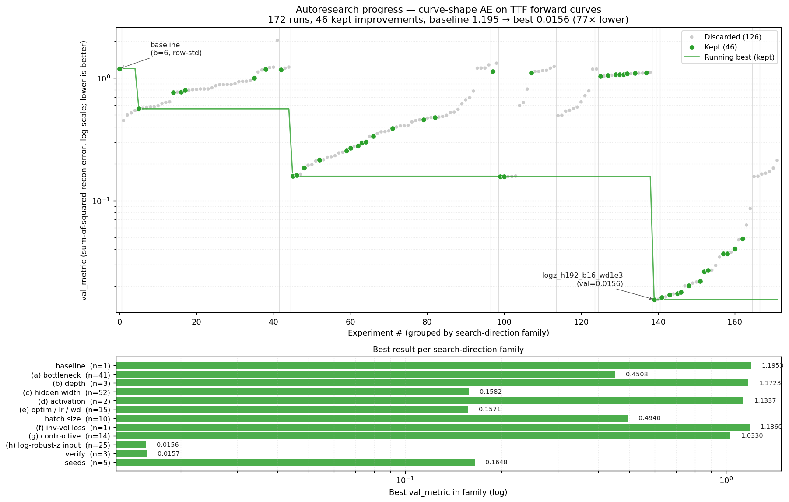

# autoresearch: Shape AE

Autonomous research loop (forked from [karpathy/autoresearch](https://github.com/karpathy/autoresearch)) retargeted from LLM pretraining to the **FERA Shape AE**. The aim is to find the best autoencoder for forward-curve **shape anomaly detection**, with the raw price curve and curve feature channels as inputs, and the price curve plus the 14 curve features as reconstruction outputs.

An agent edits `train.py`, trains one model per market for a fixed 120 s budget, scores it with a fixed metric, keeps or discards the change, and repeats.

## How it works

- **`prepare.py`** (fixed, not modified by the agent):
  - Loads curves: real data in `VW_ML_LONG` long format or M1..M36 wide format, or synthetic curves for the 7 FERA markets (TTF, THE, JKM, POWER_DE_BL, NORDIC, EUA, CSS_DE_BL).
  - Applies the LOG / ASINH(p/10) transform.
  - Builds the curve channels and the 14 features shown in the Regime AE feature-reconstruction chart.
  - Applies the live-fold split (FIT calm days ≤ 2023-12-31 / early-stop / calibration / test from 2025-08-05) and robust scalers fitted on FIT only.
  - Holds the **fixed evaluation** and the output export.
- **`train.py`** (edited by the agent): the model, the inputs it uses, the loss, the optimizer and the training loop.
- **`program.md`**: the agent's instructions, including the metric and the rules.

### Inputs and reconstruction targets

| Inputs (per market, per day) | |
|---|---|
| Curve channels (36 tenors) | `shape` (level-free T(price)), `dshape` (roll-aligned day change), `curve` (T(price) incl. level) |
| Scalar features (14) | Return z, RV 21d, Corr 20d, Front-slope Δ, Slope Δ, Back-slope Δ, Curvature Δ, Winter–summer Δ, Basis Δ, Basis level z, PCA factor 1-4 (of the daily shape change, fitted on FIT) |

The baseline model extends the deployed v3.1 architecture (`Conv1d k5 → k3 → Linear → z → mirror`) with a feature branch: an MLP encodes the 14 features, the two branches are concatenated into one latent `z` (L = 6), and two heads rebuild:

1. **the curve shape**, which is re-anchored at the observed level to give the **price curve reconstruction** in native units;
2. **the feature vector**, giving per-feature residuals in normalized feature space.

### Metric

Each test day gets an anomaly score of `max(curve RMS error / q99 calibration bar, feature RMS error / q99 calibration bar)`. **`val_score`** is the mean over markets of the AUPRC that separates clean test days from copies of test days with an **injected shape anomaly**: a kink, broken spread, front twist, seasonal hump or back-end bend, with features recomputed from the perturbed curve. A market whose clean-test shape EV is below 0.80 scores 0. Higher is better.

The injection works the same way on real curves, so the metric needs no labelled event catalogue.

### Outputs (each run, `~/.cache/autoresearch/shape_ae/outputs/`)

- `<MKT>_scores.csv`: A_GLOBAL, A_R1..A_R4, A_BUTTERFLY_MAX, A_FEAT, BAR_MULTIPLE, DECISION, SEVERITY, driver region and driver feature, A_MAHAL, TRANSITION_SCORE, and latent Z1..ZL.
- `<MKT>_curve_recon.csv`: observed vs reconstructed price per tenor, plus the scaled residual.
- `<MKT>_feature_recon.csv`: observed vs reconstructed features, plus the residuals.
- `<MKT>_latest.png`: price curve vs reconstruction, residual per tenor, and the feature residual bars for the latest day.

## Data (step 1: Snowflake source, snapshots, data quality)

`fera.toml` holds the data-source config: active markets (GAS first, so `TTF`, `THE`), the curve view and its columns, the ENTITY_ID → market map, and the optional feature-store mapping. It contains no secrets.

- **Sources:** `--source snowflake` pulls the long view; `--curves file` reads a parquet/CSV export; the default is synthetic curves. Basis-reference markets are pulled automatically.
- **Auth, tried in order:** the SPCS session token, then `connection_name` in `~/.snowflake/connections.toml`, then `SNOWFLAKE_*` env vars. Install with `uv sync --extra snowflake`.
- **Snapshots:** every pull is saved once under a content-hash id (`SNAP_<16 hex>`). The hash is verified on every load, and the id is recorded in each market's meta, so every experiment names the exact data it ran on. `--snapshot SNAP_...` re-prepares one without pulling; `--list-snapshots` lists them.
- **Data-quality gate:** checks for duplicate keys, incomplete or non-positive rows, stale (carried-forward) days, gaps, weekend dates and bad-tick jumps. Duplicates and too few complete curves stop the run unless you pass `--allow-dq-fail`.
- **Feature store** (`[features] source = "snowflake"`): mapped features use store values on clean days. Unmapped features and the PCA factors stay computed, because PCA must be fitted inside the fold. Injected days get the store value plus the computed effect of the perturbation, so the evaluation stays consistent. A parity report (corr and std ratio, computed vs store) is printed and saved per market.
- **Tests:** `python tests/test_data_sources.py` runs against a fake Snowflake connector, so no account is needed.

**SnowSQL login:** set `snowsql_connection = "<name>"` in `fera.toml` to reuse `[connections.<name>]` from `~/.snowsql/config`. A key-pair passphrase is read from `PRIVATE_KEY_PASSPHRASE`, the same env var SnowSQL uses. Fallback without the Python connector: export with SnowSQL and use the file route.

```bash
snowsql -c <name> -o output_format=csv -o header=true -o timing=false -o friendly=false \
  -q "SELECT TRADE_DATE, ENTITY_ID, MONTH_OFFSET, VALUE_NATIVE FROM RW_CF_FERA.VW_ML_LONG
      WHERE ENTITY_ID IN (1,2) AND MONTH_OFFSET BETWEEN 1 AND 36" > curves.csv
uv run prepare.py --curves curves.csv      # ENTITY_IDs are mapped to market names via fera.toml
```

**Roll days:** on the first trading day of a month, yesterday's curve is shifted one tenor (ALIGN). Today's M36 was not quoted yesterday, so it is estimated as M25 + (M36 − M24). Without this, every roll day showed a fake M36 jump in `dshape`, Back-slope Δ and the PCA factors.

## Event catalogue (step 2)

`events.py` builds the labelled catalogue that the evaluation will use:

- `mine` proposes candidates from two independent sources:
  - **CURVE**, model-free: robust z against the trailing year of the roll-aligned shape change per tenor, the tenor kink, and the spread features;
  - **SHAPE_AE**: live alert days from `AN_FERA.MODEL_SCORES`.

  It adds 20 random **CONTROL** days per market, writes `events/candidates_<SNAP>.csv` with suggested tenors and features, and leaves the label columns blank.
- `load` validates your labels (label values, tenor syntax, feature names, dates) and merges them into the git-tracked `events/events.csv`.
- `stats` summarises the catalogue.

See `events/README.md` for the labelling guide. Tests: `python tests/test_events.py`. Planted events must be found, with the right tenors.

## Quick start

```bash
uv sync
uv run prepare.py                          # synthetic curves, active markets from fera.toml
# or: uv sync --extra snowflake && uv run prepare.py --source snowflake
# or: uv run prepare.py --curves curves.parquet   (TRADE_DATE, MARKET, MONTH_OFFSET, VALUE_NATIVE)
uv run train.py                            # one experiment (~2 min, GPU if available else CPU)
```

Then point your agent at `program.md`:

```
Have a look at program.md and let's kick off a new experiment! Let's do the setup first.
```

## Project structure

```
fera.toml       — data-source config: markets, Snowflake view/columns, entity map, feature store (no secrets)
data_sources.py — Snowflake pulls, content-hashed snapshots, data-quality checks (do not modify)
events.py       — event catalogue: mine candidates, load labels (events/events.csv is tracked)
tests/          — data-layer and event tests (fake Snowflake connector, planted events)
prepare.py      — data prep, features, splits, scalers, injection, fixed metric, outputs (do not modify)
train.py        — Shape AE model, loss, optimizer, training loop (agent modifies this)
program.md      — agent instructions
pyproject.toml  — dependencies
```

---

*The original LLM-pretraining README follows for reference.*

## Original autoresearch



*One day, frontier AI research used to be done by meat computers in between eating, sleeping, having other fun, and synchronizing once in a while using sound wave interconnect in the ritual of "group meeting". That era is long gone. Research is now entirely the domain of autonomous swarms of AI agents running across compute cluster megastructures in the skies. The agents claim that we are now in the 10,205th generation of the code base, in any case no one could tell if that's right or wrong as the "code" is now a self-modifying binary that has grown beyond human comprehension. This repo is the story of how it all began. -@karpathy, March 2026*.

The idea: give an AI agent a small but real LLM training setup and let it experiment autonomously overnight. It modifies the code, trains for 5 minutes, checks if the result improved, keeps or discards, and repeats. You wake up in the morning to a log of experiments and (hopefully) a better model. The training code here is a simplified single-GPU implementation of [nanochat](https://github.com/karpathy/nanochat). The core idea is that you're not touching any of the Python files like you normally would as a researcher. Instead, you are programming the `program.md` Markdown files that provide context to the AI agents and set up your autonomous research org. The default `program.md` in this repo is intentionally kept as a bare bones baseline, though it's obvious how one would iterate on it over time to find the "research org code" that achieves the fastest research progress, how you'd add more agents to the mix, etc. A bit more context on this project is here in this [tweet](https://x.com/karpathy/status/2029701092347630069).

## How it works

The repo is deliberately kept small and only really has three files that matter:

- **`prepare.py`** — fixed constants, one-time data prep (downloads training data, trains a BPE tokenizer), and runtime utilities (dataloader, evaluation). Not modified.
- **`train.py`** — the single file the agent edits. Contains the full GPT model, optimizer (Muon + AdamW), and training loop. Everything is fair game: architecture, hyperparameters, optimizer, batch size, etc. **This file is edited and iterated on by the agent**.
- **`program.md`** — baseline instructions for one agent. Point your agent here and let it go. **This file is edited and iterated on by the human**.

By design, training runs for a **fixed 5-minute time budget** (wall clock, excluding startup/compilation), regardless of the details of your compute. The metric is **val_bpb** (validation bits per byte) — lower is better, and vocab-size-independent so architectural changes are fairly compared.

If you are new to neural networks, this ["Dummy's Guide"](https://x.com/hooeem/status/2030720614752039185) looks pretty good for a lot more context.

## Data (step 1: Snowflake source, snapshots, data quality)

`fera.toml` holds the data-source config: active markets (GAS first, so `TTF`, `THE`), the curve view and its columns, the ENTITY_ID → market map, and the optional feature-store mapping. It contains no secrets.

- **Sources:** `--source snowflake` pulls the long view; `--curves file` reads a parquet/CSV export; the default is synthetic curves. Basis-reference markets are pulled automatically.
- **Auth, tried in order:** the SPCS session token, then `connection_name` in `~/.snowflake/connections.toml`, then `SNOWFLAKE_*` env vars. Install with `uv sync --extra snowflake`.
- **Snapshots:** every pull is saved once under a content-hash id (`SNAP_<16 hex>`). The hash is verified on every load, and the id is recorded in each market's meta, so every experiment names the exact data it ran on. `--snapshot SNAP_...` re-prepares one without pulling; `--list-snapshots` lists them.
- **Data-quality gate:** checks for duplicate keys, incomplete or non-positive rows, stale (carried-forward) days, gaps, weekend dates and bad-tick jumps. Duplicates and too few complete curves stop the run unless you pass `--allow-dq-fail`.
- **Feature store** (`[features] source = "snowflake"`): mapped features use store values on clean days. Unmapped features and the PCA factors stay computed, because PCA must be fitted inside the fold. Injected days get the store value plus the computed effect of the perturbation, so the evaluation stays consistent. A parity report (corr and std ratio, computed vs store) is printed and saved per market.
- **Tests:** `python tests/test_data_sources.py` runs against a fake Snowflake connector, so no account is needed.

## Quick start

**Requirements:** A single NVIDIA GPU (tested on H100), Python 3.10+, [uv](https://docs.astral.sh/uv/).

```bash

# 1. Install uv project manager (if you don't already have it)
curl -LsSf https://astral.sh/uv/install.sh | sh

# 2. Install dependencies
uv sync

# 3. Download data and train tokenizer (one-time, ~2 min)
uv run prepare.py

# 4. Manually run a single training experiment (~5 min)
uv run train.py
```

If the above commands all work ok, your setup is working and you can go into autonomous research mode.

## Running the agent

Simply spin up your Claude/Codex or whatever you want in this repo (and disable all permissions), then you can prompt something like:

```
Hi have a look at program.md and let's kick off a new experiment! let's do the setup first.
```

The `program.md` file is essentially a super lightweight "skill".

## Project structure

```
prepare.py      — constants, data prep + runtime utilities (do not modify)
train.py        — model, optimizer, training loop (agent modifies this)
program.md      — agent instructions
pyproject.toml  — dependencies
```

## Design choices

- **Single file to modify.** The agent only touches `train.py`. This keeps the scope manageable and diffs reviewable.
- **Fixed time budget.** Training always runs for exactly 5 minutes, regardless of your specific platform. This means you can expect approx 12 experiments/hour and approx 100 experiments while you sleep. There are two upsides of this design decision. First, this makes experiments directly comparable regardless of what the agent changes (model size, batch size, architecture, etc). Second, this means that autoresearch will find the most optimal model for your platform in that time budget. The downside is that your runs (and results) become not comparable to other people running on other compute platforms.
- **Self-contained.** No external dependencies beyond PyTorch and a few small packages. No distributed training, no complex configs. One GPU, one file, one metric.

## Platform support

This code currently requires that you have a single NVIDIA GPU. In principle it is quite possible to support CPU, MPS and other platforms but this would also bloat the code. I'm not 100% sure that I want to take this on personally right now. People can reference (or have their agents reference) the full/parent nanochat repository that has wider platform support and shows the various solutions (e.g. a Flash Attention 3 kernels fallback implementation, generic device support, autodetection, etc.), feel free to create forks or discussions for other platforms and I'm happy to link to them here in the README in some new notable forks section or etc.

Seeing as there seems to be a lot of interest in tinkering with autoresearch on much smaller compute platforms than an H100, a few extra words. If you're going to try running autoresearch on smaller computers (Macbooks etc.), I'd recommend one of the forks below. On top of this, here are some recommendations for how to tune the defaults for much smaller models for aspiring forks:

1. To get half-decent results I'd use a dataset with a lot less entropy, e.g. this [TinyStories dataset](https://huggingface.co/datasets/karpathy/tinystories-gpt4-clean). These are GPT-4 generated short stories. Because the data is a lot narrower in scope, you will see reasonable results with a lot smaller models (if you try to sample from them after training).
2. You might experiment with decreasing `vocab_size`, e.g. from 8192 down to 4096, 2048, 1024, or even - simply byte-level tokenizer with 256 possibly bytes after utf-8 encoding.
3. In `prepare.py`, you'll want to lower `MAX_SEQ_LEN` a lot, depending on the computer even down to 256 etc. As you lower `MAX_SEQ_LEN`, you may want to experiment with increasing `DEVICE_BATCH_SIZE` in `train.py` slightly to compensate. The number of tokens per fwd/bwd pass is the product of these two.
4. Also in `prepare.py`, you'll want to decrease `EVAL_TOKENS` so that your validation loss is evaluated on a lot less data.
5. In `train.py`, the primary single knob that controls model complexity is the `DEPTH` (default 8, here). A lot of variables are just functions of this, so e.g. lower it down to e.g. 4.
6. You'll want to most likely use `WINDOW_PATTERN` of just "L", because "SSSL" uses alternating banded attention pattern that may be very inefficient for you. Try it.
7. You'll want to lower `TOTAL_BATCH_SIZE` a lot, but keep it powers of 2, e.g. down to `2**14` (~16K) or so even, hard to tell.

I think these would be the reasonable hyperparameters to play with. Ask your favorite coding agent for help and copy paste them this guide, as well as the full source code.

## Notable forks

- [miolini/autoresearch-macos](https://github.com/miolini/autoresearch-macos) (MacOS)
- [trevin-creator/autoresearch-mlx](https://github.com/trevin-creator/autoresearch-mlx) (MacOS)
- [jsegov/autoresearch-win-rtx](https://github.com/jsegov/autoresearch-win-rtx) (Windows)

## License

MIT
